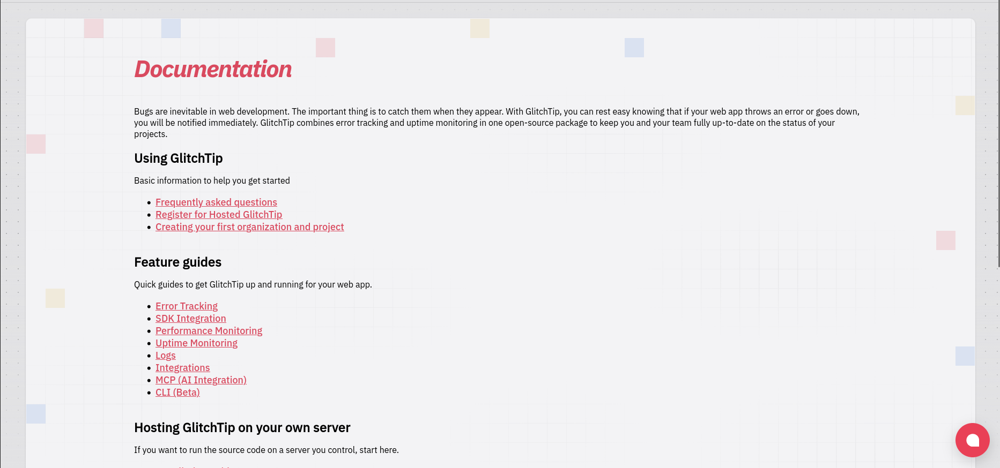
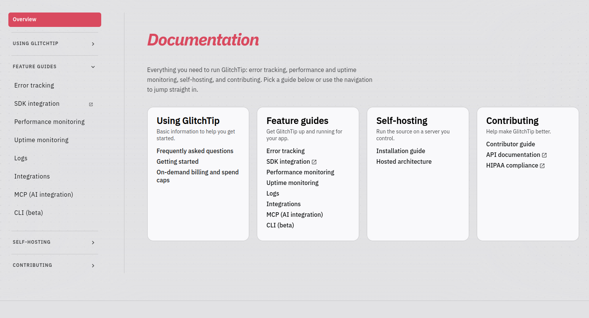
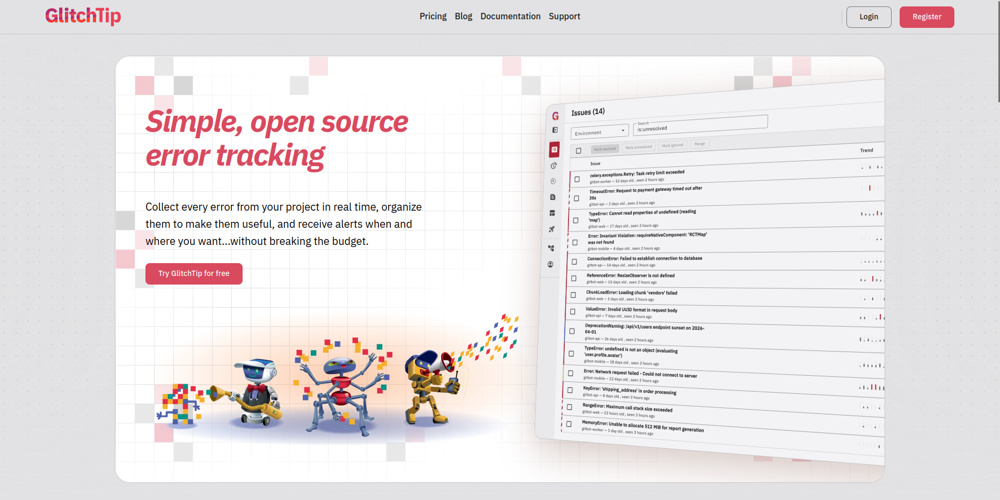

We rewrote our Terms of Service, Privacy Policy, and Data Processing Agreement in plain language. The short version: your data is yours, we don't sell it or use it to train AI, and our DPA now covers free plans as well as paid ones. New accounts are on the new terms today. Existing accounts move over on **November 21, 2026**.

We also rebuilt glitchtip.com from the ground up, starting with docs that are much easier to find your way around.

## What we promise now

Our old terms were short and left a lot unsaid. The new [Terms of Service](https://glitchtip.com/legal/tos), [Privacy Policy](https://glitchtip.com/legal/privacy), and [Data Processing Agreement](https://glitchtip.com/legal/data-processing-agreement) spell out what we promise, what we expect from you, and what happens to your data.

### Your data is yours

You own the data you send us. We use it to run GlitchTip for you, and nothing else. We **still** don't sell it or use it to train AI models, and now that's in writing.

### The DPA covers every plan

Our DPA used to apply only to personal data covered by GDPR or similar laws. Now it applies whenever we process personal data on your behalf, on free and paid plans alike. You don't need to sign anything. Paid customers who need a signed copy can email support@glitchtip.com, and we consider requests case by case.

Other DPA changes:

- **Subprocessors:** We still email you at least 10 business days before adding or replacing a subprocessor, and you can object. If we can't resolve your objection, you can now cancel and get a refund of any prepaid fees for the unused period.
- **Retention:** Events are deleted after 90 days by default, or when you delete them. Deleted data is gone from backups within 35 days.
- **Liability:** The DPA now uses the same liability cap as our Terms instead of setting its own.

### What's in the Terms

- **Acceptable use:** Don't intentionally send special category data (health, biometric, genetic, and so on). Don't send PHI unless you have a signed BAA with us. BAAs are available on the Large plan for app.glitchtip.com; see our [HIPAA page](https://glitchtip.com/hipaa).
- **Free plan:** Provided as is, with no uptime or support commitment.
- **Cancellation:** Cancel any time from your subscription settings. The Terms now explain what happens to your data afterward.

The Privacy Policy was rewritten too. It has separate sections for the hosted service and this website, the legal basis for each use of your data, how long we keep it, and your rights.

### A subprocessor we missed

While reviewing everything, we found that Chatwoot, which runs our support email and the in-app chat on app.glitchtip.com, was never listed as a subprocessor. We've used it since launch. It's now listed on our [Hosted Architecture](https://glitchtip.com/documentation/hosted-architecture) page, along with what it receives and how long it keeps it.

We also changed how the chat loads. It used to load on every page of the site and the app. Now nothing is sent to Chatwoot until you open the chat, and if it can't load you'll see our support email instead. If you object to us using Chatwoot, email support@glitchtip.com.

### When this takes effect

New accounts accept the new terms when they sign up. Existing accounts move to them on November 21, 2026. Until then, the [previous Terms](https://glitchtip.com/legal/tos-2026-07-22), [Privacy Policy](https://glitchtip.com/legal/privacy-2026-07-22), and [DPA](https://glitchtip.com/legal/data-processing-agreement-2026-07-22) still apply. You don't need to do anything. If you don't agree, cancel any paid subscription and delete your organization or account before November 21.

## Docs you can find your way around

The biggest change to glitchtip.com is the documentation. Here's before and after:

<strong>Before</strong>

<strong>After</strong>

The docs now have a sidebar for navigation, a table of contents that follows you as you scroll, and a copy button on every code block.

Self-hosting? Read the new [PostgreSQL tuning](https://glitchtip.com/documentation/install#postgresql-tuning) section. It covers the one setting most installs get wrong, and new Docker Compose installs now set it for you.

## Also new on glitchtip.com

GlitchTip now has one clean design system, from glitchtip.com to the app.

- **Home page:** A new hero and a feature switcher, so you can tab between Error Tracking, Performance Monitoring, Uptime Monitoring, and Logs instead of scrolling a long list.
- **Pricing:** The plans table was rebuilt, and the wording on the free plan and data retention is clearer.
- **Support:** The support page now shows every way to reach us in one place.
- **Link previews:** Share a glitchtip.com link in Slack, Mastodon, or anywhere else and you'll get a proper preview card.

## What's next

GlitchTip 7.0 is well on its way. If you follow our repos on GitLab, you've probably seen the activity. Highlights include on-demand billing, a permissions rework, and plenty of efficiency upgrades. We haven't set a date yet, so for now the answer is "soon."

**[Read the new Terms](https://glitchtip.com/legal/tos)**, **[browse the docs](https://glitchtip.com/documentation)**, or **[try GlitchTip free](https://app.glitchtip.com/register)**.

## Support us

GlitchTip is 100% built and funded by users. No VC. We have no one to answer to but you.

### Support the project

- 🛡️ [Get Enterprise Support](mailto:support@glitchtip.com?subject=Purchasing%20enterprise%20support) (For Business) for $15 per user per month
- 💖 [Individual License](mailto:support@glitchtip.com?subject=Purchasing%20an%20individual%20license) (For Supporters) for $5 per month
- 💸 Donate via [Liberapay](https://en.liberapay.com/GlitchTip). We currently receive $26.77 per week from 21 patrons.

### Community & Social

- ⭐ on [GitLab](https://gitlab.com/glitchtip/glitchtip-backend/). Help us reach 400 stars!
- ⭐ on [Docker Hub](https://hub.docker.com/r/glitchtip/glitchtip), where we have over 5 million pulls
- ❤️ on [AlternativeTo](https://alternativeto.net/software/glitchtip/about/) and leave a review. AlternativeTo generates [significant](https://plausible.io/glitchtip.com?period=30d) website traffic.
- ⏩ Follow on [Mastodon](https://mastodon.online/@glitchtip) or [BlueSky](https://bsky.app/profile/glitchtip.com)
